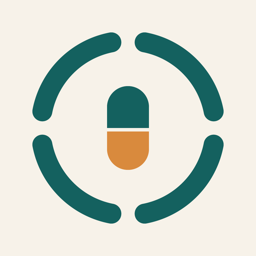

# ADHS Track für Home Assistant



Verbindet die iOS-App **ADHS Track** mit Home Assistant. Du brauchst weder Nabu Casa noch die Companion-App: Die App schickt ihre Daten per Webhook an deine eigene HA-Adresse.

- **Körperwerte** als Sensoren mit Verlauf: Recovery, Schlaf (% und Dauer), Strain, Ruhepuls, HRV, Atemfrequenz und letzte Herzfrequenz.
- **Körper-Journal**: Koffein, Alkohol, Flüssigkeit, Stimmung und Energie.
- **Aufgaben** als To-do-Liste, in HA abhakbar. Die App übernimmt den Haken beim nächsten Abgleich.
- **Kalender** mit Aufgaben und geplanten Einnahmen für heute bis +6 Tage.
- **Medikamente**: Ereignisse zur Erinnerungszeit (nur wenn noch nicht eingenommen) und bei jeder Einnahme. Einnahmen lassen sich auch aus HA erfassen, z. B. per NFC-Tag.
- **Training live**: Puls, Trainingszone und Tempohinweis während Rudern oder Yoga, plus ein Ereignis bei Zonenwechsel.
- **Dashboard-Karten** als Gegenstück zu den App-Widgets. Sie werden automatisch geladen.

Voraussetzung: Home Assistant 2026.11 oder neuer. Die Anbindung muss in der App für dein Konto freigeschaltet sein.

## Installation

### Manuell oder zum Testen

1. Installiere das Add-on **Terminal & SSH** und öffne es.
2. Klone das Repository und verlinke die Integration:
   ```sh
   cd /config
   git clone https://github.com/Sedrah87/HASS-ADHSTrack.git
   mkdir -p custom_components
   ln -s /config/hass-adhstrack/custom_components/adhstrack custom_components/adhstrack
   ```
3. Starte Home Assistant neu.
4. Updates holst du später mit `cd /config/hass-adhstrack && git pull` und einem Neustart.

### Marketplace (HACS) – empfohlen

[](https://my.home-assistant.io/redirect/marketplace_repository/?owner=Sedrah87&repository=HASS-ADHSTrack&category=integration)

1. Klicke auf den Knopf, dann öffnet sich dein Home Assistant direkt beim Repository. Ohne Knopf geht es über **Einstellungen › Marketplace › Add from link** mit `Sedrah87/HASS-ADHSTrack`.
2. Installiere „ADHS Track“ und starte Home Assistant neu.
3. Richte die Integration ein:

   [](https://my.home-assistant.io/redirect/config_flow_start/?domain=adhstrack)

Beim ersten Klick fragt my.home-assistant.io einmalig nach der Adresse deines Home Assistant.

Quelle ist [github.com/Sedrah87/HASS-ADHSTrack](https://github.com/Sedrah87/HASS-ADHSTrack). [github.com/Sedrah87/HASS-ADHSTrack](https://github.com/Sedrah87/HASS-ADHSTrack) ist ein automatischer Spiegel; Issues bitte dort auf GitHub melden.

## Einrichtung

1. Öffne **Einstellungen › Geräte & Dienste › Integration hinzufügen › ADHS Track**.
2. Gib die interne URL ein, z. B. `http://192.168.1.5:8123` oder `http://homeassistant.local:8123`.
3. Gib optional eine externe **https**-URL für unterwegs an.
4. Öffne auf dem iPhone den angezeigten Link **„In ADHS Track öffnen“**, z. B. in der HA-App. Die App übernimmt Adressen und Webhook-ID und startet den ersten Abgleich.

Du kannst die Daten in der App auch von Hand eintragen, unter **Mehr › Home Assistant**. Die Optionen der Integration zeigen den Link erneut an und können eine neue Webhook-ID erzeugen.

> Die Webhook-ID ist das Zugangsgeheimnis, gib sie nicht weiter. Außerhalb des Heimnetzes immer https verwenden, denn es werden Gesundheitsdaten übertragen.

## Wann die App abgleicht

- beim Öffnen und Schließen der App
- nach jeder Änderung, gebündelt nach 5 s
- nach iCloud-Änderungen von anderen Geräten
- nach Körper-Updates, auch über die stündliche Health-Hintergrundaktualisierung
- per iOS-Hintergrundabruf, dessen Takt iOS bestimmt

In HA abgehakte Aufgaben und erfasste Einnahmen sind in HA sofort sichtbar. In der App kommen sie beim nächsten Abgleich an, und jeder Befehl wird dort genau einmal angewendet.

## Entitäten

| Entität | Inhalt |
|---|---|
| `sensor.*_recovery`, `*_schlaf`, `*_schlafdauer`, `*_strain`, `*_ruhepuls`, `*_hrv`, `*_atemfrequenz`, `*_letzte_herzfrequenz` | Körperwerte (Statistik/Verlauf) |
| `sensor.*_koffein`, `*_alkohol`, `*_fluessigkeit`, `*_stimmung`, `*_energie` | Journal von heute |
| `sensor.*_offene_aufgaben_heute`, `*_ueberfaellige_aufgaben`, `*_inbox`, `*_agenda` | Aufgaben (Listen als Attribute) |
| `sensor.*_offene_einnahmen_heute`, `*_naechste_einnahme` | Medikamente (Plan als Attribut) |
| `sensor.*_trainingszone`, `*_trainingspuls`, `binary_sensor.*_training_aktiv` | Training live |
| `binary_sensor.*_medikament_faellig` | Eine Einnahme ist fällig und noch offen |
| `todo.*_aufgaben` | Heutige und überfällige Aufgaben |
| `calendar.*_kalender` | Aufgaben und Einnahmen für heute bis +6 Tage |

Die Entitäts-IDs hängen von der Sprache ab. Die Karten finden ihre Entitäten deshalb selbst.

## Ereignisse

| Ereignis | Daten |
|---|---|
| `adhstrack_medikament_erinnerung` | `medikament`, `med_id`, `dosis`, `einheit`, `kritisch`, `einnahme_um`, `erinnerung_um` |
| `adhstrack_medikament_eingenommen` | `medikament`, `med_id`, `zeit`, `quelle` |
| `adhstrack_trainingszone_geaendert` | `zone`, `vorherige_zone`, `zonen_name`, `puls`, `hinweis`, `aktivitaet` |
| `adhstrack_training` | `aktiv`, `aktivitaet` |

## Dienste

- `adhstrack.einnahme_erfassen`: `medikament` als Name oder ID, optional `zeitpunkt`. Ohne `medikament` werden alle heute fälligen Einnahmen erfasst.
- `adhstrack.aufgabe_erledigen`: `uid` (siehe Attribut `aufgaben` der Agenda), optional `erledigt` (Standard: an).

Hat die App dasselbe Medikament schon in diesem Zeitfenster (±90 min) erfasst, verwirft sie den Befehl. So entstehen keine Doppel-Einnahmen.

## Dashboard-Karten

Alle Karten findest du unter **Karte hinzufügen**, Suchbegriff „ADHS Track“. Sie lassen sich ohne YAML einrichten.

```yaml
type: custom:adhstrack-agenda-card       # Heute / 3 / 7 Tage, abhakbar
zeitraum: heute
---
type: custom:adhstrack-tagesplanung-card # groesse: s | m | l (Zeitleiste)
groesse: l
---
type: custom:adhstrack-uhr-card          # modus: 12h | 6h
modus: 6h
---
type: custom:adhstrack-inbox-card
---
type: custom:adhstrack-recovery-card
---
type: custom:adhstrack-strain-card
---
type: custom:adhstrack-medikamente-card  # „Einnehmen“ / „Alle fälligen einnehmen“
```

## Beispiel-Automationen

```yaml
# Licht rot, wenn ein kritisches Medikament fällig ist
triggers:
  - trigger: event
    event_type: adhstrack_medikament_erinnerung
    event_data:
      kritisch: true
actions:
  - action: light.turn_on
    target: { entity_id: light.flur }
    data: { color_name: red }
---
# NFC-Tag an der Medikamentenbox
triggers:
  - trigger: tag
    tag_id: medikamentenbox
actions:
  - action: adhstrack.einnahme_erfassen
---
# Ventilator stärker ab Trainingszone 4
triggers:
  - trigger: event
    event_type: adhstrack_trainingszone_geaendert
conditions:
  - condition: template
    value_template: "{{ trigger.event.data.zone >= 4 }}"
actions:
  - action: fan.set_percentage
    target: { entity_id: fan.trainingsraum }
    data: { percentage: 100 }
```

## Entwicklung

```sh
uv venv --python 3.14 .venv
uv pip install --python .venv/bin/python -r requirements_test.txt
.venv/bin/python -m pytest
docker run --rm --platform linux/amd64 -v "$PWD/custom_components:/github/workspace/custom_components" ghcr.io/home-assistant/hassfest
```

Das Protokoll zwischen App und Integration (JSON, Version `v: 1`) ist im App-Repository unter `Doku/HOME_ASSISTANT_2026-11-03.md` beschrieben.

## Lizenz

[PolyForm Noncommercial 1.0.0](LICENSE.md) (SPDX: `PolyForm-Noncommercial-1.0.0`) – © 2026 Sedrah87.

Erlaubt ist die nicht-kommerzielle Nutzung: privat, als Hobby, zu Lern- und Forschungszwecken sowie durch gemeinnützige Organisationen. Ändern und Weitergeben unter denselben Bedingungen ist ebenfalls erlaubt. **Verkauf und jede andere kommerzielle Nutzung sind nicht erlaubt.** Wer eine kommerzielle Lizenz möchte, fragt bitte direkt an.

Name und Logo „ADHS Track“ fallen nicht unter diese Lizenz und dürfen nicht für eigene Produkte oder abgewandelte Versionen verwendet werden.

## Hinweis

ADHS Track und diese Integration sind **kein Medizinprodukt**. Sie ersetzen keine ärztliche Beratung. Erinnerungen und Ereignisse können ausbleiben oder verspätet eintreffen, zum Beispiel ohne Netz, wenn Home Assistant nicht läuft oder die App lange nicht abgeglichen hat. Verlass dich bei der Einnahme von Medikamenten nicht allein darauf. Die Nutzung erfolgt ohne Gewähr, siehe Abschnitt „No Liability“ der Lizenz.
